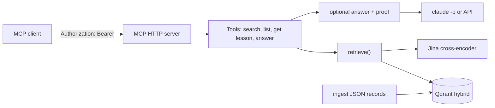
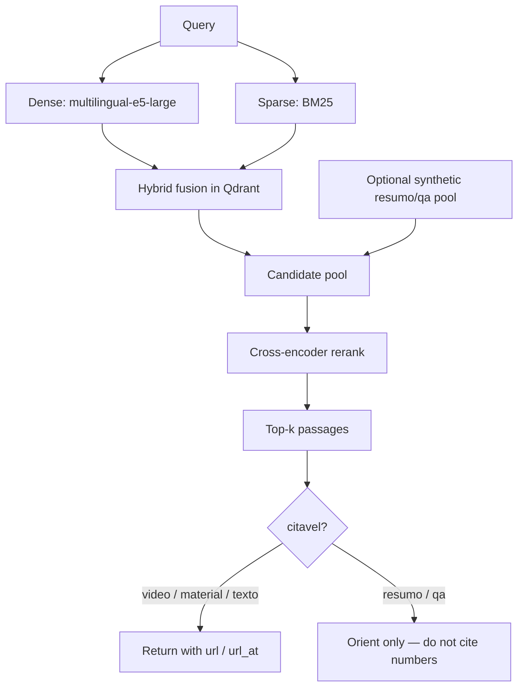

# rag-mcp

Hybrid search + cross-encoder rerank over Qdrant, exposed as an **MCP server**.
Ingest a corpus of documents (the demo uses public-domain Brazilian legal excerpts),
retrieve passages with citations, and optionally generate an answer that keeps only
sentences the retrieved text can prove.

This repository is a **portfolio / demo** of a retrieval pipeline. It is not a
hosted product and this README does not claim a production deployment.

Code in this repo was **co-written with coding agents** (Claude Code, Cursor, and
similar tools) and then reviewed, tested, and edited by a human. Treat it as
engineered software, not as an unattended dump of model output.

## Why this exists

Most “RAG demos” stop at “embed and hope.” This one is built around failure modes
that showed up while iterating on a Portuguese hybrid retriever:

- Dense retrieval alone misses exact legal terms; BM25 alone misses paraphrase.
- A large corpus drowns short distilled notes unless the candidate pool is explicit.
- An LLM will invent numbers and “frameworks” unless citation is checked in code.
- Putting a secret in the URL leaks it into access logs, proxies, and screenshots.

The public tree ships a **small legal sample** so anyone can run the same pipeline
end-to-end without a private corpus.

## Architecture



## Retrieval pipeline



What each stage does:

1. **Ingest** — JSON records → sentence/late chunks → dense + sparse vectors in Qdrant.
   A small SQLite ledger records ingest status; it does not decide what to upsert.
2. **Retrieve** — hybrid search (e5-large + BM25), optional HyDE / decomposition,
   then a multilingual cross-encoder rerank.
3. **Contract** — `resumo`/`qa` chunks are marked `citavel=false`. They help locate
   a lesson; they must not be quoted as fact.
4. **Answer (optional)** — a generator proposes sentences; a verifier and a
   citation checker drop anything without a literal span. Closed failure:
   “Não encontrei isso nos trechos recuperados.”

Default `k` for the MCP search tool is 10 (rerank pool ~50+20). The CLI default
is 15. Those numbers came from latency/quality measurements on a large private
collection that is **not** in this tree; re-tune on your own corpus.

## Quick start (Docker Compose)

Requirements: Docker, ~5 GB disk on first run (embedding + rerank models).

```bash
cp .env.example .env
# set MCP_AUTH_TOKEN to >=16 random characters
docker compose up --build -d qdrant mcp
docker compose --profile ingest run --rm ingest
curl -s http://127.0.0.1:8000/healthz
```

`ingest` reads `sample/corpus/legal/*.json` (mounted at `/app/data`) into
collection `legal_rag`. Re-run it after changing the sample.

Without Docker:

```bash
python -m venv .venv && source .venv/bin/activate
pip install -r requirements.txt
# Qdrant on localhost:6333
cp -R sample/corpus/. data/
python -m ingest.ingest
MCP_TRANSPORT=http MCP_AUTH_TOKEN=change-me-min-16-chars python -m rag.mcp_server
```

stdio mode (local MCP client, no HTTP auth):

```bash
python -m rag.mcp_server
```

## Connect from an MCP client

HTTP transport, **token in the Authorization header only** (not in the path or
query string):

```json
{
  "mcpServers": {
    "rag-mcp": {
      "url": "http://127.0.0.1:8000/mcp",
      "headers": {
        "Authorization": "Bearer ${MCP_AUTH_TOKEN}"
      }
    }
  }
}
```

stdio example:

```json
{
  "mcpServers": {
    "rag-mcp": {
      "command": "python",
      "args": ["-m", "rag.mcp_server"],
      "env": {
        "QDRANT_URL": "http://127.0.0.1:6333",
        "COLLECTION_NAME": "legal_rag"
      }
    }
  }
}
```

Useful tools: `documentacao`, `buscar_transcricoes`, `encontrar_aula`,
`obter_aula`, `answer`, `saude`. Tool names and prompts are in Portuguese because
the original corpus and eval set were Portuguese.

A missing or wrong `Authorization` header on `/mcp` returns **401**. `/healthz`
stays public.

## Environment

See `.env.example`. The ones you almost always set:

| Variable | Role |
|---|---|
| `QDRANT_URL` | Qdrant HTTP URL |
| `QDRANT_API_KEY` | Qdrant API key (optional locally) |
| `COLLECTION_NAME` | Default collection (`legal_rag` in the demo) |
| `MCP_AUTH_TOKEN` | Bearer secret, ≥16 chars, HTTP mode |
| `MCP_HTTP_PATH` | MCP path (default `/mcp`) |
| `MCP_ALLOWED_HOSTS` | Host allow-list; empty disables the check |
| `EMBED_MODEL` / `RERANK_MODEL` | Must match the vectors already in Qdrant |
| `RAG_RERANK` | `0` skips the cross-encoder |

## Eval approach and limitations

`eval/` is a retrieval-and-citation harness, not a leaderboard.

- **Goldens** (`eval/golden_legal.jsonl`) ask questions whose answers sit in the
  sample excerpts. Metrics: lesson/primary recall@k, facet coverage, numeric
  hallucination, LLM-as-judge faithfulness.
- **Traps** (`eval/traps_legal.jsonl`) are questions the corpus should refuse.
- **Split** — `eval/split.json` freezes calibration vs test so prompt tweaks
  cannot silently overfit the held-out side.
- **Funnel** — `eval/run_funnel.py` records *where* evidence dies (first search,
  rerank, k-cut, generation).
- **Gate** — `eval/run_gate.py` compares a new run to a baseline after a human
  reviews flagged sentences.

Limitations of the public sample:

- Five short legal excerpts. Recall numbers here do **not** transfer to a
  multi-hundred-thousand-chunk collection.
- Cross-encoder and e5-large downloads are heavy; CI does not run them (`slow`
  and `live` markers are skipped by default).
- The optional `answer` tool needs a Claude CLI login or an API key. Unit tests
  mock that path.
- Faithfulness judges are themselves models. The code-side citation check is the
  hard gate; the judge is a second opinion.

```bash
python -m pytest                          # default: not slow, not live
python -m eval.run_eval --no-answer --k 6 # needs a running Qdrant + ingested sample
```

## Layout

- `rag/` — retrieve, rerank, MCP server, optional proven answer
- `ingest/` — chunking, upsert, ingest ledger, secret scan before embed
- `eval/` — goldens, traps, funnel, gate
- `sample/corpus/` — public legal JSON records
- `tests/` — pytest (no private services)
- `Dockerfile` / `docker-compose.yml` — HTTP MCP + Qdrant

## Publishing an image

`.github/workflows/publish-ghcr.yml` builds `ghcr.io/<owner>/<repo>` on push to
`main`. It does nothing until this repository (or a **new** public copy) has
Actions enabled. This working copy does not publish images.

## License

MIT. Sample legal texts are official Brazilian federal publications (not
copyrighted as literary works); excerpts are attributed to Planalto URLs.
